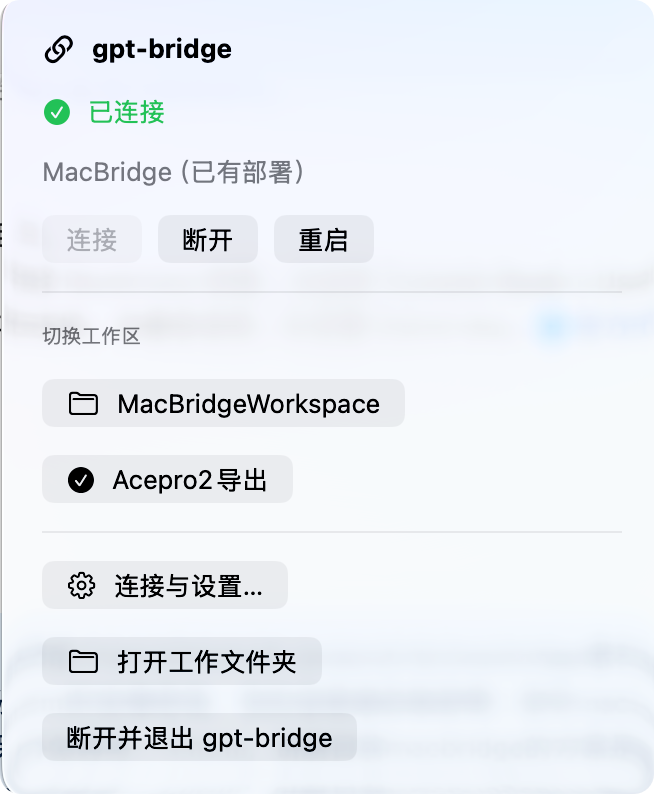
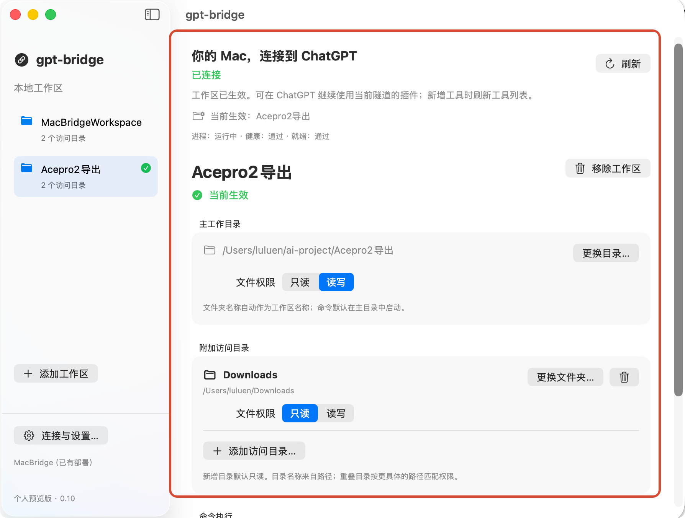
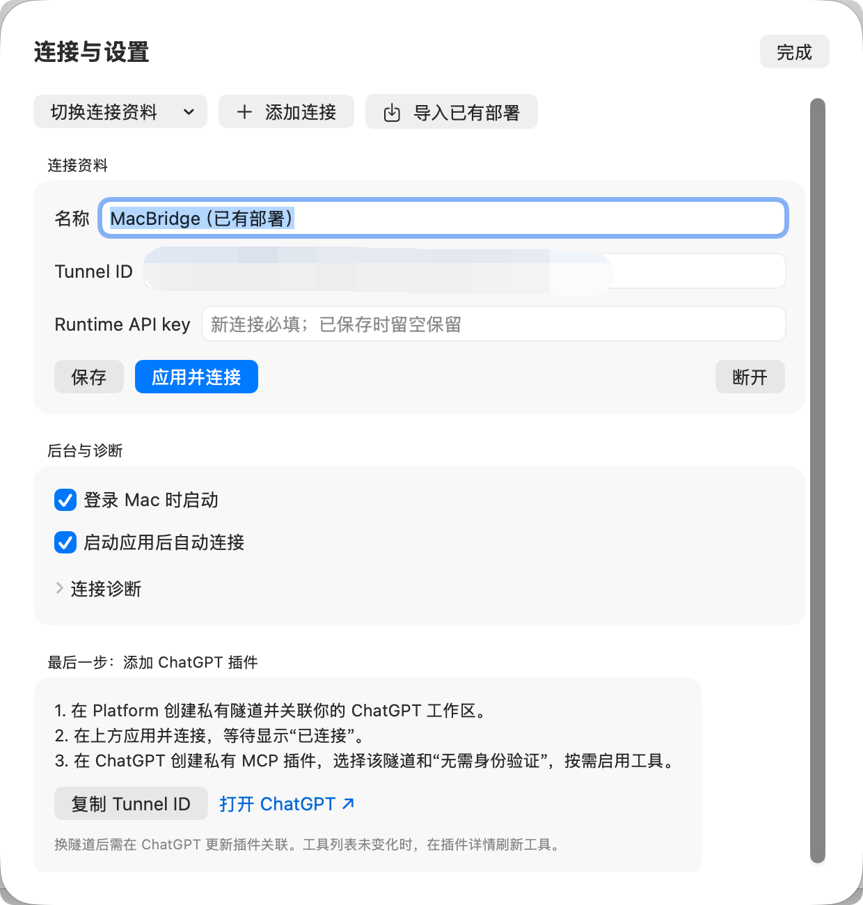
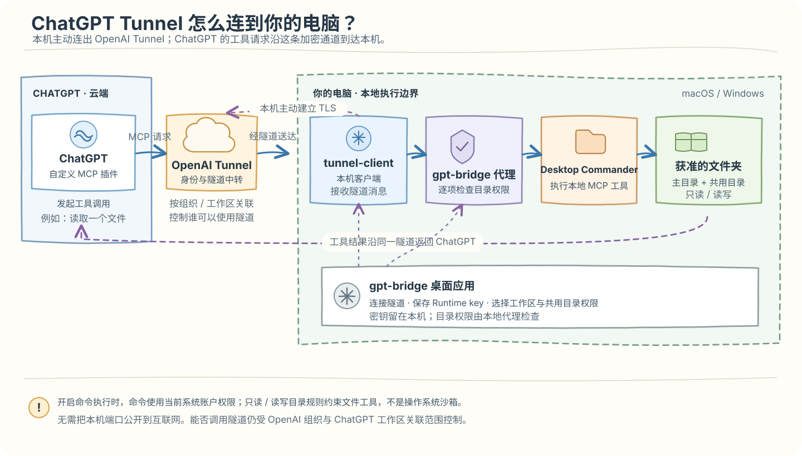

# gpt-bridge

把你的 Mac 或 Windows 电脑连接到 ChatGPT：在网页中使用私有 MCP 插件，读取本地资料、写入授权目录，并按需执行本机命令。桌面应用负责隧道连接、工作区和目录权限；日常使用无需运行终端脚本。

> 📘 第一次部署 MacBridge？建议先看[单文件部署教程](macbridge素材/MacBridge-部署教程.html)，按步骤完成隧道、桌面端、ChatGPT 插件和真实文件读写验证。教程截图已内嵌，下载这个 HTML 后即可独立打开。

[下载 macOS 0.11](https://github.com/lulalulaluobo/gpt-bridge/releases/tag/v0.11) · [全部版本](https://github.com/lulalulaluobo/gpt-bridge/releases) · [macOS 说明](desktop/README.md) · [Windows 托盘版说明](windows/README.md)

## 产品截图

### 菜单栏快速控制

查看连接状态、断开或重启连接，并快速切换工作区。



### 共用目录权限

共用目录只需添加一次，即可在所有工作区复用；每个目录单独设置只读或读写。



### 连接设置

管理隧道连接、后台启动及诊断。



## ChatGPT Tunnel 原理

ChatGPT 不会直连你的电脑端口。本机 `tunnel-client` 主动与 OpenAI Tunnel 建立加密连接；MCP 请求经云端中转到本机后，由 gpt-bridge 权限代理检查，再交给本地工具执行，结果沿同一隧道返回。隧道关联限制云端谁能调用；本地目录权限限制文件工具能访问哪些路径。



## Windows 托盘版

新增 Windows 10 / 11 x64 原生桌面应用。图标常驻任务栏右侧托盘，关闭或最小化设置窗口后继续连接；双击图标打开设置，右键菜单可切换工作区、连接、断开和退出。支持共用目录的只读 / 读写权限、单独命令开关、登录启动及自动连接，Runtime key 使用当前 Windows 用户的 DPAPI 加密保存。

在 Windows 上运行 `python windows/scripts/package.py` 后，再运行 `python windows/scripts/installer.py`，生成包含全部依赖的单文件安装包 `windows/dist/gpt-bridge-0.11-windows-x64-setup.exe`。双击安装，从开始菜单打开，无需手动解压或另装 Node.js；同时提供 ZIP 便携版。当前为未签名预览版，尚未发布 Windows Release 附件。[Windows 的使用、构建与验证](windows/README.md)

## 0.11 的功能

- 原生 macOS 菜单栏应用，显示名称为 **gpt-bridge**。
- 保存多个本地工作区，每次启用一个；主目录随工作区切换。
- 使用 macOS 文件夹选择器添加或更换目录，名称直接取路径末尾的文件夹名，无需另填名称。
- **共用目录只需添加一次，适用于所有工作区和连接资料**，逐目录选择“只读”或“读写”。
- 主界面按工作区、共用目录分开管理；连接状态只显示一次，操作固定在底部，详细诊断收进设置。
- 命令执行单独开关；切换工作区和连接前检查活动任务。
- Runtime API key 保存在本机钥匙串；可选登录 Mac 时启动、打开应用后自动连接。

## 安装

目前提供 Apple Silicon（arm64）版本，要求 macOS 14 或更新版本。

1. 下载 Release 中的 `gpt-bridge-0.11-arm64.dmg`，打开后将 `gpt-bridge.app` 拖入 Applications。
2. 从 Applications 打开应用，通过顶部菜单栏进入设置。安装完成后可以推出 DMG。
3. 当前发行包使用个人临时签名，尚未获得 Developer ID 签名和 Apple 公证。macOS 若拦截首次打开，可在确认来源后，通过“系统设置 → 隐私与安全性 → 仍要打开”处理；无需全局关闭系统安全检查。

## 首次连接

### 1. 创建私有隧道和 Runtime key

在 [OpenAI Platform 的 Tunnels 设置](https://platform.openai.com/settings/organization/tunnels)创建隧道，只关联你打算使用的组织及私人 ChatGPT 工作区。复制以 `tunnel_` 开头的 Tunnel ID。

在同一组织的 [API keys 设置](https://platform.openai.com/settings/organization/api-keys)创建具备隧道 **Read + Use** 权限的 Runtime API key。管理隧道所用的管理权限与桌面运行所需权限分别配置；把 Runtime key 填入本机应用，保存到钥匙串，不要提交到仓库或发进聊天。

这些入口需要你的账号具备相应权限；若入口不可用，先核对组织、ChatGPT 工作区及账号权限。

### 2. 在应用中配置

填写 Tunnel ID 和 Runtime API key，使用文件夹选择器选择主工作目录。在侧栏“共用目录”中添加资料或输出文件夹，设置只读或读写，点击“应用并连接”。已有密钥时输入框留空表示继续使用已保存密钥。

顶部显示“已连接”后进行网页调用。需要排查时，在“连接与设置 → 后台与诊断 → 连接诊断”查看进程、健康检查和隧道就绪状态。

### 3. 添加 ChatGPT 插件

在 ChatGPT 设置中创建私有自定义 MCP 插件，连接方式选择 **Tunnel / 隧道**，选中同一隧道。此本地 MCP 服务使用“无需身份验证”；私有隧道仍受组织及 ChatGPT 工作区关联范围约束。保持平台工具操作确认，按需启用工具。

在新对话中用 `@` 选中插件，实际调用 `read_file` 读取授权目录里的一个测试文件。ChatGPT 界面入口和可用权限可能因账号而异。

升级增加工具后，可在插件设置中刷新工具。切换本地工作区继续复用同一隧道，无需为每个项目重建插件；更换隧道则需要更新网页插件的连接。

## 工作区和权限

工作区是当前本地项目，主目录提供默认工作位置。共用目录在应用中统一管理，可用于资料库、下载或输出文件夹；切换工作区和连接资料后继续生效。名称均由所选目录的最后一段路径自动生成。

“保存”只保存配置；“应用并连接”才更新当前运行器。菜单栏切换工作区使用已保存的共用权限。修改或移除共用目录后，需要应用才能改变正在运行的连接；存在活动任务时不会强制切换。

| 设置 | 文件工具的行为 |
| --- | --- |
| 只读 | 允许读取、查看、搜索；拒绝写入和修改 |
| 读写 | 允许读取及写入、编辑、创建、移动等已开放操作 |
| 未授权目录 | 拒绝访问 |
| 共用目录 | 所有工作区使用同一份权限 |
| 未选中的工作区主目录 | 不额外授权；若属于共用目录范围，则按共用权限访问 |

写入检查在本地执行层落实，不依靠 ChatGPT 自觉遵守提示词。移动文件时同时检查源和目标，路径及符号链接会按实际目标检查。嵌套共用目录按更具体的路径匹配权限；将只读共用目录或其子目录选为工作区主目录时，主目录继承只读，不能借切换工作区提升为读写。

**命令开关具有独立含义。** 开启后，命令按当前 Mac 用户权限运行，可能读取或修改文件工具授权范围以外的内容；目录只读规则不是命令的操作系统沙箱。需要文件工具遵守只读范围时，应关闭命令执行。若希望任意程序也无法写入只读目录，需要另行使用系统级隔离。[Desktop Commander 的权限说明](https://github.com/wonderwhy-er/DesktopCommanderMCP/blob/main/SECURITY.md)介绍了这一限制。

本版不向插件暴露 PDF 写入/生成功能；`read_file` 的 PDF 读取按底层能力提供。核心连接和文件、命令功能不需要下载 Chrome。

关闭设置窗口后，菜单栏应用和连接继续运行。“断开并退出”会先停止运行器；有活动任务时先等待完成或取消任务。关机、休眠或网络断开期间远程调用可能不可用，重新连接不能让原进程跨关机继续运行。

## 从 MacBridge 升级

gpt-bridge 0.11 保留原应用身份、钥匙串服务及数据目录，可读取已有 MacBridge 配置和凭据。旧单目录配置会迁移为一个本地工作区。

0.10 的附加目录自动合并到共用目录；相同实际路径去重，权限冲突保留只读。原有工作区、当前选择、命令开关和启动偏好保留。首次保存升级配置时，原配置备份为数据目录中的 `connections-v1-backup.json`。新版配置为 schema 2；回退 0.10 时须在退出应用后恢复旧配置备份，旧版不能直接读取 schema 2。

升级前先断开并退出 MacBridge，安装 gpt-bridge 后从 Applications 打开。不要同时运行两个版本；确认新版本正常后，可移除旧 `/Applications/MacBridge.app`。不要删除旧应用数据目录或钥匙串条目。

- 配置、运行记录及专用执行层 HOME：`~/Library/Application Support/MacBridge/`
- 钥匙串服务：`local.macbridge.desktop.runtime`
- 原脚本版部署：`~/.local/share/macbridge/`，可通过应用的导入入口迁移；原文件不会随升级删除。

应用名称更新不意味着需要重建已连接的 ChatGPT 插件。网页插件名称可按个人习惯保留或修改。

## 源码构建

需要 Apple Silicon Mac、Xcode Command Line Tools（含 Swift）、Python 3.9 或更新版本、可访问官方下载及 npm registry 的网络。

```bash
git clone https://github.com/lulalulaluobo/gpt-bridge.git
cd gpt-bridge/desktop
python3 scripts/bootstrap-runtime.py
swift test
python3 scripts/package.py --dmg
```

输出为 `desktop/dist/gpt-bridge-0.11-arm64.dmg`。打包结束默认移除临时 `.app`，避免出现多个应用入口；本机测试需要保留时追加 `--keep-app`。

固定构建输入为 Node.js `24.9.0`、OpenAI tunnel-client `0.0.16`、Desktop Commander `0.2.52`。下载脚本校验官方归档的 SHA-256；执行层使用仓库内的 `desktop/runtime/package-lock.json` 和 `npm ci --ignore-scripts`，不复制用户的配置、密钥或运行中的依赖树。已有可信的相同版本构建输入可使用 `--node <bin/node>`、`--runtime-source <目录>`。

应用内 `Contents/Resources/Licenses/` 保留第三方许可证和依赖清单，`build-manifest.json` 记录版本及构建输入摘要。源码中保留部分 `MacBridge` 内部名称用于兼容旧数据，这些内部名称不影响显示名称。

## 已知依赖限制

0.10 保留 Desktop Commander 0.2.52，并固定 `sharp 0.35.5`、`uuid 11.1.1`，将 `md-to-pdf` 的命令行 watcher 依赖单独替换为 `chokidar 4.0.3`。已验证图像转换、ExcelJS 工作簿读写、模块加载和 watcher 基本兼容。

2026-10-13 的 `npm audit` 结果仍有 **6 个 moderate 依赖项、0 个 high、0 个 critical**，并非全部无漏洞。残留项来自同一条 `md-to-pdf → gray-matter → js-yaml 3 → argparse 1 → sprintf-js` 依赖链；`sprintf-js` 当时没有已发布的补丁版本。直接把 js-yaml 升至 4 会破坏 gray-matter 使用的 `safeLoad / safeDump` API，因此没有强制升级或降级 Desktop Commander。

此链用于 PDF 生成的 frontmatter 处理及 js-yaml 命令行工具；当前 MCP 代理不暴露 PDF 生成/写入工具，普通文件读取与 PDF 读取不会调用 argparse 命令行路径。PDF 读取中可使用的 sharp 已升级修复。启用任意本机命令后，程序仍可自行调用本机第三方库，因此不能把这些组件的默认工具路径限制视为操作系统隔离。

## 项目范围

这是个人使用预览版。仓库未指定自有源码的开放许可证；第三方组件分别遵循随包许可证。发布包尚未完成 Apple 公证，后续对外稳定分发需补齐正式签名、公证和跨机器安装验证。
